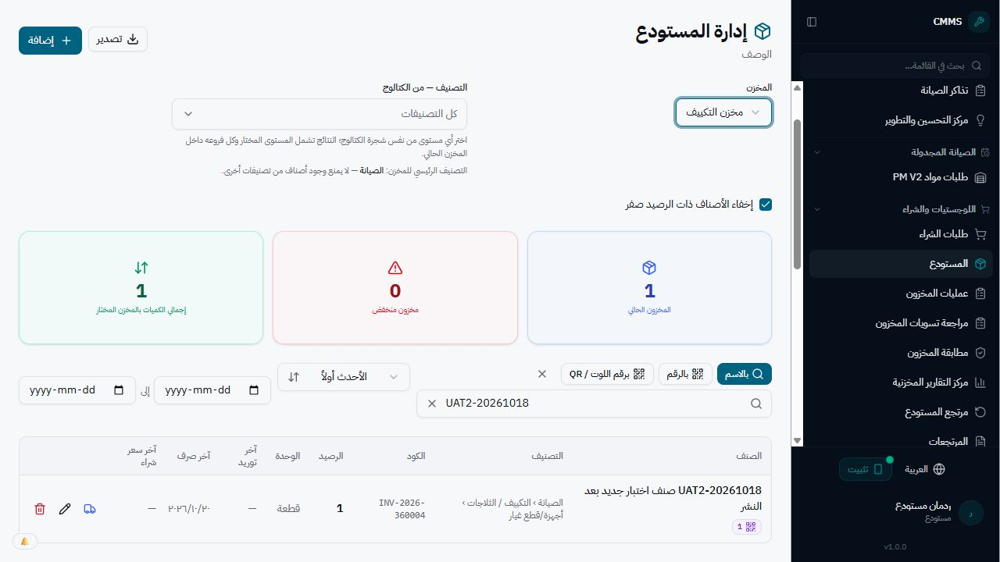
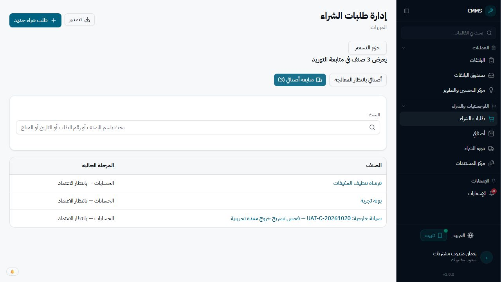
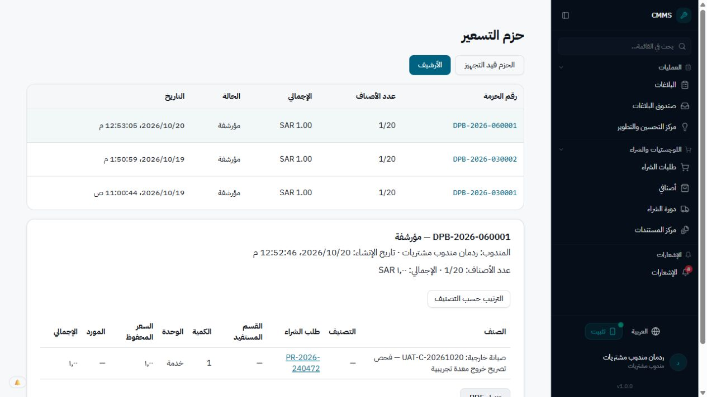
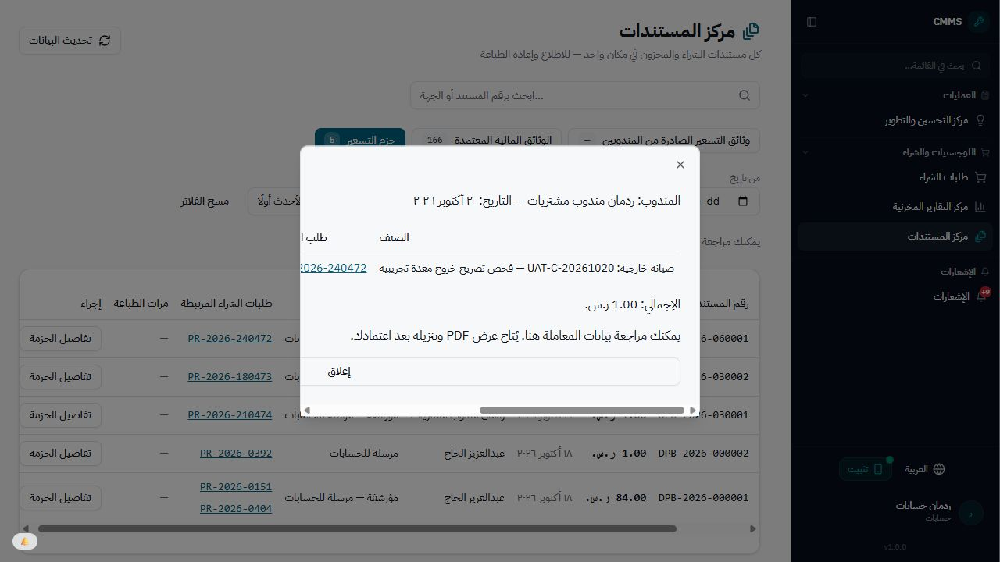
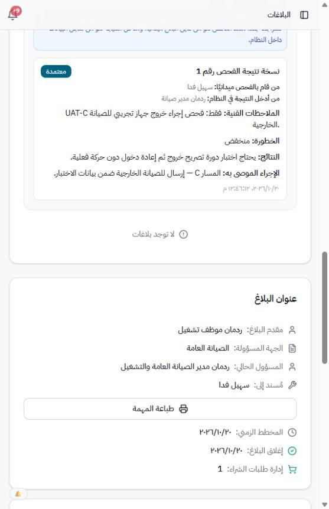
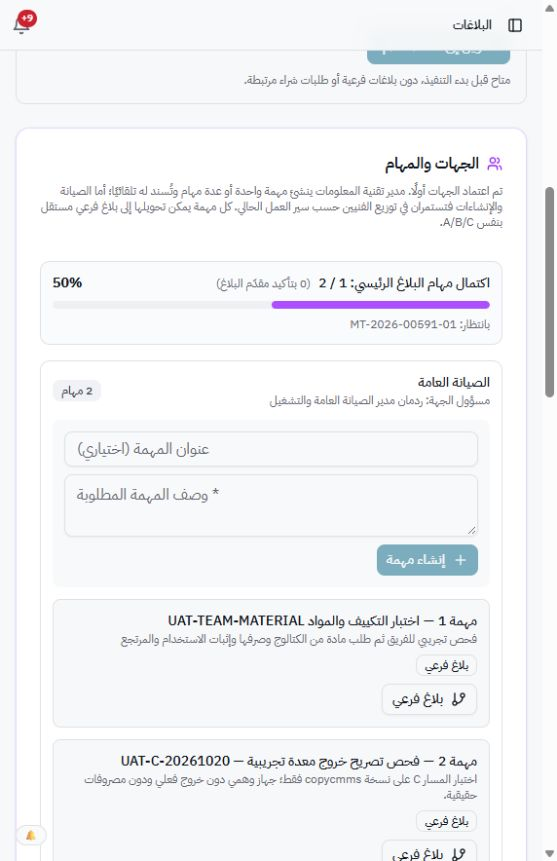
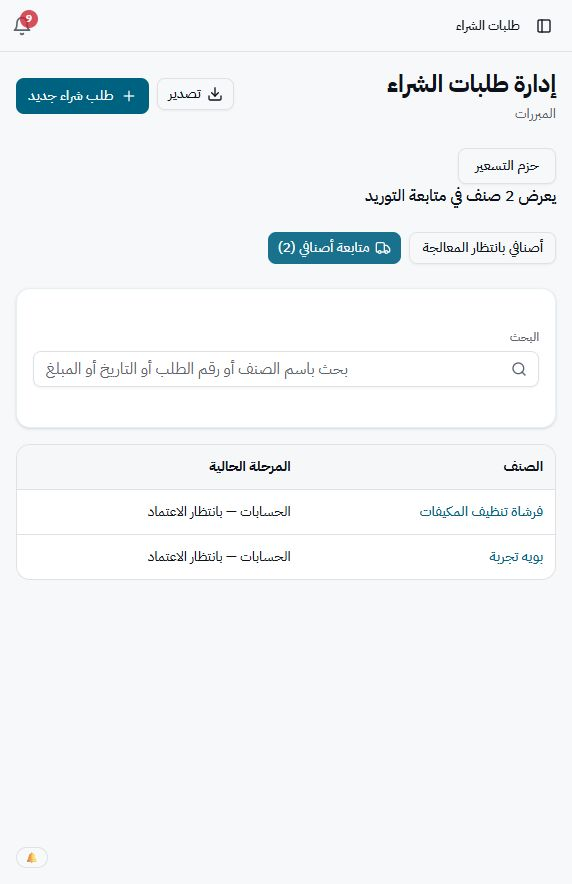

> تحديث متابعة لاحق: اختبار الصرف من اللوت المطابق نجح فعليًا بسند DLV-2026-510001 ثم أُعيدت القطعة كاملة، وصافي التكلفة صفر. الملاحظة السابقة بأن اللوتات كلها معطلة غير صحيحة؛ بقي تحذير اختلاف الأرصدة والوحدات فقط. المستخدم تجاوز اختبار الأجهزة الفعلية وأجّل اختبار تعطيل الجلسات. التفاصيل في continuation/REPORT_AR.md.

# متابعة اختبارات المتصفح — 20 أكتوبر 2026

البيئة هي خدمة Railway التي أكد المستخدم اتصالها بـ `copycmms`. لم يُنفذ اتصال مباشر بقاعدة البيانات أو SQL أو اختبار API خارج واجهة البرنامج. لم تُختبر المشاريع أو الصيانة الدورية. لا إصلاحات كود ضمن هذه الجولة.

**تحديث ختامي لهذه الجولة:** اكتمل المسار C التجريبي MT591-02 حتى الإغلاق، واختبرت شروط PDF قبل الاعتماد وبعده للدورين على الحزمة نفسها بمساعدة المستخدم في الاعتماد المالي. الرئيسي بقي 50% بسبب الفرع الآخر، واختفى صنف C المكتمل من متابعة المندوب. أعيد فتح MT593 من صاحبه RED7 بعد التأكيد بنجاح، فلا توجد مشكلة صلاحية مثبتة لهذا السيناريو.

## الحالات التي اكتملت

| الاختبار | النتيجة والدليل |
|---|---|
| إرسال مسودة دون احتياج | رفض الإرسال مع إبقاء المسودة، وذكر اسم الصنف المطلوب استكماله. |
| إدخال الأيام والتاريخ بالاتجاهين | 3 أيام ولدت 23 أكتوبر؛ اختيار 26 أكتوبر من التقويم جعل الأيام 6. لا يُحسب ملء التاريخ الآلي الذي لم يطلق حدث التقويم اختبارًا فاشلًا للتطبيق. |
| حفظ المسودة وإرسالها | الطلب `3810005` أصبح `PR-2026-240471` وبقي تاريخ الاحتياج 26 أكتوبر. لوحظ انتظار أثناء الحفظ. لم يُختبر الإرسال في يوم تقويمي تالٍ. |
| اعتماد الصرف التشغيلي متعدد الأصناف | وافق المستودع على `OPR-2026-030002`، وانتقلت حالته إلى معتمد للصرف. |
| إضافة نقص التشغيل إلى الشراء | الصنف الصفري أُضيف بضغطة واحدة إلى المسودة `3840001` مع مرجع الأمر والبند والكمية 1؛ استُبدل الإجراء برابط المسودة. |
| التحويل بين مخزنين فرعيين | `TRB-2026-180001`: قطعة من التكييف إلى الدهانات، بعد التأكيد الأحمر. |
| التحويل العكسي | `TRB-2026-180002`: إعادة القطعة إلى التكييف. تأكد رصيد الفرع 1 بعد العودة. |
| منع الصرف المستقل من دورة الشراء | رُفضت المحاولة برسالة «الصرف يتطلب بلاغ صيانة أو مهمة أو أمر صرف تشغيلي معتمد». بقي رصيد قطعة اللوت `779` دون خصم بعد إعادة التحميل. |
| تأكيد مقدم البلاغ | حفظ RED7 تأكيد البلاغ `MT-2026-00593` باسمه وتاريخه وملاحظته. |
| إنشاء فرع تجريبي جديد | أُنشئت مهمة ثانية داخل البلاغ التجريبي `MT-2026-00591` وأسندت لسهيل، وتحولت إلى `MT-2026-00591-02` برقم `2100001`. لم تتغير مهام البلاغ الأولى. |
| الفحص واختيار C | حفظت نتيجة فحص جديدة، مع فصل منفذ الفحص عن مدخلها. اعتمد مدير الصيانة المسار C مع سبب إلزامي. |
| تجهيز تصريح C | رفع المستودع صورة اختبار، وحدد المندوب RED3؛ صدر `EXT-OUT-2026-120001` وانتقل للحراسة. |
| خروج البوابة | أكد RED5 الخروج التجريبي، فانتقل التصريح إلى السجل وأنشئ الطلب `PR-2026-240472` آليًا. لم تخرج معدة فعلية. |
| وصول C إلى المندوب | ظهر الصنف لدى RED3، مرتبطًا بطلب `3840002` وبند `3810002`. سجل سعرًا تجريبيًا قدره ريال واحد دون شراء فعلي. |
| حزمة C الجديدة | أضيف الصنف إلى `DPB-2026-060001` ثم أُرسل للحسابات، وانتقلت الحزمة إلى الأرشيف تلقائيًا. لوحظ اكتمال الإرسال خلال نافذة رصد مقدارها 31 ثانية؛ هذا حد الرصد وليس قياسًا دقيقًا لزمن الخادم. |
| PDF المندوب | لم يظهر قبل الإرسال. ظهر بعده ونجح تنزيل `DPB-2026-060001.pdf`. |
| متابعة صنف C | عرض تبويب متابعة أصنافي الصنف ومرحلة «الحسابات — بانتظار الاعتماد». |
| مستندات الحسابات | ظهرت الحزمة الجديدة وربط الطلب وتفاصيل الأصناف؛ لم يظهر زر PDF قبل اعتماد الحسابات. |
| مستندات الإدارة العليا | البيانات متاحة للمراجعة؛ PDF محجوب قبل اعتماد الإدارة مع رسالة واضحة. |
| مطابقة تكلفة التنفيذ | التقرير: مصروف 176 − مرتجع 86 = صافي 90 ريالًا. مجموع المواقع والأقسام 60 + 30 + 0 = 90. |
| تكلفة البلاغ والتشغيل | `MT-2026-00593-01`: مصروف 2، مرتجع 1، صافي 1. و`OPR-2026-030001` كذلك. تطابق مع السندات. |
| إظهار فرق اللوت والمتوسط | `MT-2026-00589-02`: صافي اللوت 20 مقابل المتوسط 15؛ الفرق 5 ظاهر. |

## المشكلات والملاحظات التي ظهرت

- **تفاصيل المحاسب بعد الاعتماد:** تكررت على الطلب الجديد PR240472 حالة «لا توجد بيانات» ورفض الاطلاع على الطلب، رغم نجاح تنزيل ملف اعتماده من مركز المستندات.
- **تصنيف مهمة C لدى الفني:** بعد تسليم المستودع ظهرت «بانتظار المواد» مع أنها تنتظر بدء التركيب. فتح التفاصيل سمح ببدء التركيب وإكماله؛ انتقلت بعد الإنجاز إلى «تم تنفيذها» بصورة صحيحة.
- **تسمية صورة الفاتورة:** داخل تأكيد الشراء ظهرت باسم «ملاحظات الحسابات»، بينما الخادم يطلب صورة الفاتورة وصورة الصنف.

1. **تحديث رصيد التحويل:** بعد نقل القطعة إلى الدهانات لم يجدها بحث التحويل العكسي؛ ظهرت بعد تحديث الصفحة. التحويل نفسه نجح ولم يضع الرصيد.
2. **تعذر صرف صنف متوفر في التشغيل:** صنف `731025` داخل `OPR-2026-030002` يعرض رصيدًا، لكن اللوتات معطلة بسبب تحذير اختلاف الوحدات أو عدم تطابق بيانات اللوت. لم نتجاوز الحارس ولم نحدد السبب من الكود أو القاعدة.
3. **استجابة الصرف المرفوض غير واضحة:** نموذج دورة الشراء أغلق بعد المحاولة المرفوضة؛ ثبت الرفض من سجل أخطاء المتصفح وثبات المخزون، لكن رسالة النتيجة لم تبق واضحة في الشاشة.
4. **نطاق استعراض التشغيل يحتاج حسمًا:** RED7 شاهد قائمة المخزون والأرصدة والأسعار وزر التصدير عند فتح `/inventory` حتى بعد إعادة التحميل، رغم غياب المستودع من قائمته. لم تظهر أزرار الصرف والتعديل. لا يُصنف خلل صلاحيات مؤكدًا دون مراجعة السياسة المقصودة.
5. **عرض ما بعد تأكيد البلاغ:** بعد تأكيد MT593 ظهرت عبارة «لا توجد بلاغات» داخل قسم الإجراءات وتغير شكل خطواته. حفظ التأكيد نفسه نجح.
6. **فتح وثيقة C لم يُحسم:** الضغط على وثيقة الخروج من المستودع والحراسة لم ينتج نافذة أو تنزيلًا مرصودًا. قد يكون عائق نافذة منبثقة في المتصفح؛ لا يُحكم بأنه عطل مؤكد في الملف دون عزل السبب. لذلك زر إغلاق معاينة التصريح لم يُختبر.
7. **انتظار بعض الكتابات:** حفظ المسودة والفحص والتصريح والإرسال أظهر انتظارًا. لم يُقاس سبب التأخر من الخادم في هذه الجولة.
8. **عائق أداة المتصفح:** تعثر التحكم بإحدى النوافذ واستعيد العمل بنافذة أخرى. لا يُسجل كخلل تطبيق.

## المتبقي أو غير المحسوم

- إتمام شراء واستلام وصرف المسودة المرتبطة بنقص التشغيل `3840001`، ومعالجة عائق اللوت للصنف المتوفر.
- استبدال مرتجع المورد: تأكد عرض `RTN-2026-240003` مرتبطًا بـ `RCV-2026-540002` و`PR-2026-180472`، لكن استلام البديل وربطه لم يُنفذ.
- أثر تعطيل حساب نشط فورًا لم يُختبر بهذه الجولة.
- اختبار توقيعات المستودع والمحاسب على مستندات جديدة مع توقيع وبدونه لم يكتمل.
- تجربة احتياج محفوظ ثم إرسال في يوم تقويمي آخر لم تُنفذ.
- تجميع أصل فعلي غير فارغ لم يُختبر؛ جميع المراجع الحالية «دون أصل محدد». فلتر PMV2 أظهر صفر حركات؛ هذا لا يثبت دورة تكلفة PMV2 عمليًا.
- الطابعة والقارئ الفعليان يحتاجان جهاز المستخدم.

## أدلة

هذه متابعة لحالات متبقية من جولات سابقة، وليست إعلانًا باكتمال اختبار الخمسين تعديلًا بالكامل.

## تحديث بعد تدخل المستخدم للاعتماد المالي

- أكد المستخدم تنفيذ اعتمادي الحسابات والإدارة لطلب C التجريبي. تحققنا من حالة «معتمد» لدى RED3.
- نجح تنزيل وثيقة اعتماد الحسابات وPDF حزمة DPB060001 من RED4 بعد اعتماده، كما نجح تنزيل PDF الحزمة من RED8 بعد اعتماده. بذلك اكتمل اختبار قبل/بعد للحزمة الجديدة نفسها في الدورين.
- تأكد على الطلب الجديد أيضًا خلل رابط بيانات المعاملة من حساب المحاسب بعد الاعتماد: «لا توجد بيانات» مع رفض صلاحية، رغم إتاحة ملف الاعتماد. الدليل accountant-after-approval-no-data.png.

- المندوب أكمل تسجيل شراء خدمة C بعد صور اختبار؛ ظهر تم الشراء بالكامل 1/1.
- أكد الحارس دخول الجهاز التجريبي؛ انتقل إلى بانتظار استلام المستودع.

- استلام المستودع وتسليم سهيل اكتمل، وعرضت متابعة المسار C ست مراحل منتهية وبانتظار بدء التركيب.

- **اكتمل المسار C حتى الإغلاق**: بدأ SUHAIL التركيب، وحفظ الإنجاز، وانتقل الفرع إلى جاهز للإغلاق، ثم أغلقه RED6. رقم الفرع MT-2026-00591-02، الطلب PR-2026-240472، الحزمة DPB-2026-060001، تصريح الخروج EXT-OUT-2026-120001 والعودة EXT-RET-2026-120001.
- ظهرت مشكلة تصنيف لدى الفني: بعد تسليم الأصل ظهر C تحت «بانتظار المواد» بدل «مهام التنفيذ»، رغم توفر زر بدء التركيب داخل تفاصيله. بعد الإنجاز انتقل إلى «تم تنفيذها» بصورة صحيحة.

## أدلة ختامية إضافية

بقيت التجربتان DPB030001 وDPB030002 على حالتهما السابقة بانتظار الحسابات؛ لم نعد اعتماد سجلاتهما. تحقق السيناريو المالي الكامل على DPB060001 الجديدة. لم نختبر حزمة شراء تقليدية جديدة متعددة الطلبات بهذه الجولة، ولا حالة حساب معطّل ذي جلسة نشطة، ولا توقيعًا مرفوعًا وبدونه على المستندات الجديدة.
