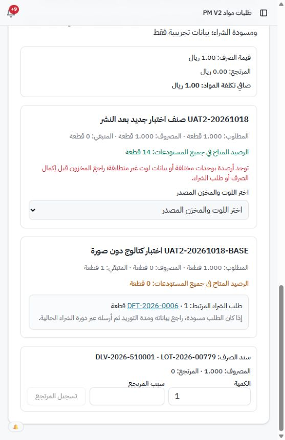
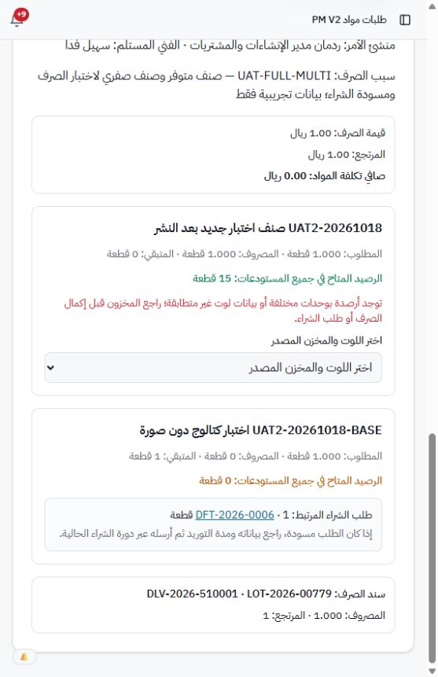
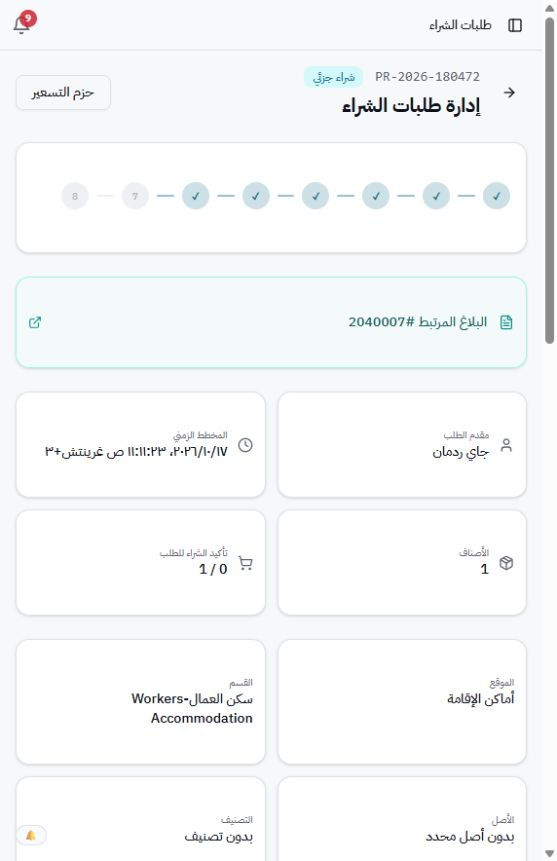
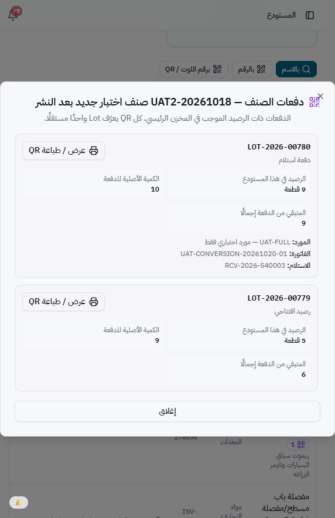

# استكمال الحالات المتبقية — 20 أكتوبر 2026

العمل عبر واجهة Railway المرتبطة حسب تأكيد المستخدم بـcopycmms. لا اتصال مباشر بالقاعدة ولا تعديلات كود.

## الصرف التشغيلي واللوت

أُعيد الاختبار على OPR-2026-030002. اتضح أن قائمة اللوتات غير معطلة، خلاف الملاحظة السابقة. اختيار LOT-2026-00779 من المخزن الرئيسي أتاح صرف قطعة بقيمة ريال؛ نجح التأكيد وصدر DLV-2026-510001. صار المطلوب1 والمصروف1 والمتبقي0، وانخفض رصيد اللوت5 إلى4.

أُعيدت القطعة كاملة من واجهة المرتجع المرتبط بالسند نفسه، فرجع اللوت إلى5، والإجمالي إلى15، وصار المصروف1 ريال والمرتجع1 ريال وصافي التكلفة0. لذلك اختبار الصرف من اللوت المطابق والمرتجع نجح، ولا توجد مشكلة منع شاملة مثبتة.

بقي تحذير اختلاف الوحدات/اللوتات، وعرض رصيد إجمالي15 مقابل لوتات مؤهلة مجموعها6؛ مصدر الفرق لم يُحدد من الكود أو القاعدة بهذه الجولة.

## بديل مرتجع المورد

فُحص الطلب PR-2026-180472 برقم3780002 من المستودع والمندوب. الرأس «شراء جزئي»0/1، وبنده الوحيد «تم التسليم لمقدم الطلب» بكمية2. لا يظهر إجراء لاستبدال المرتجع أو إعادة الشراء. شاشة إدخال المخزون المرتبطة بالطلب لا تعرض أصنافًا متاحة، ودورة الشراء لا تعرض توريدًا معلقًا. المرتجع الأصلي RTN-2026-240003 محفوظ، لكن إكمال استلام بديله لم يتوفر في المسارات التي فُحصت. لم ننشئ فاتورة أو شراءً زائدًا للتحايل على ذلك.

## التوقيعات

نُزّل DLV-2026-510001.pdf بنجاح من مركز المستندات. معاينة الواجهة لم تُظهر نافذة مرصودة، وفتح الملف المحلي بأداة التصفح مُنع بسياسة الأمان؛ لم تُستخدم وسيلة التفاف. طلب من المستخدم فتح الملف. أجاب «نعم» على ظهور توقيع مستخدم المستودع وعلى وجود توقيع مرفوع لحساب RED. هذه نتيجة تحقق بصري من المستخدم.

تأكد من واجهة المستخدمين أن RED4 لديه توقيع مرفوع، وتحمّلت صورته (شعار الملقا). طلب المستخدم تجاوز المقارنة البصرية داخل مستند اعتماده، لذلك لم نؤكد ظهور توقيع المحاسب داخل PDF. حالة إصدار مستند جديد بلا توقيع لم تُختبر؛ لم تُغير توقيعات الحسابات.

## قرارات المستخدم

- تجاوز اختبار الطابعة والقارئ الفعليين.
- تأجيل اختبار تعطيل الجلسات.

## الأدلة

## تحديد أدق لعائق اللوت

توضح نافذة دفعات الصنف في الرئيسي أن LOT-2026-00780 يحتوي9 قطع من استلام RCV-2026-540003، إضافة إلى5 قطع في LOT779. خيارات الصرف التشغيلي عرضت LOT779 الرئيسي5 وفرع التكييف1 فقط، ولم تعرض LOT780. الكمية الناقصة من خيارات الصرف هي9، وتطابق تمامًا رصيد LOT780. كلا اللوتين ظاهر بوحدة «قطعة» في نافذة المخزون. هذه ملاحظة واجهة مؤكدة؛ سبب الاستبعاد البرمجي لم يفحص في هذه الجولة.

## الخلاصة العملية

- نجح صرف اللوت المطابق وإرجاعه.
- بقي استبعاد دفعة الاستلام المحوّلة LOT780 من قائمة الصرف التشغيلي للمراجعة.
- بديل مرتجع المورد لم يمكن إكماله بالمسارات المتاحة؛ توجد حالة رأس شراء جزئي مع بند مسلم بلا إجراء بديل.
- توقيع المستودع ظهر بحسب التأكيد البصري للمستخدم.
- توقيع المحاسب مرفوع ويعرض في ملف المستخدم؛ مقارنة ظهوره داخلPDF تم تجاوزها بطلب المستخدم.
- اختبار تعطيل الجلسات مؤجل بطلب المستخدم، واختبار الأجهزة متجاوز بطلبه.
- لم تتغير أدوار أو كلمات مرور أو تواقيع، ولم تُنفذ SQL أو تغييرات كود.
