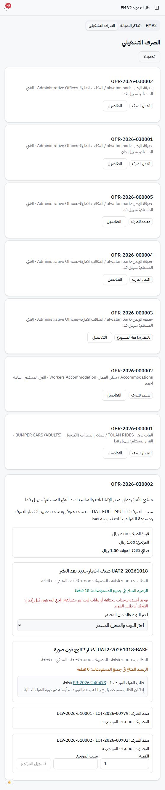
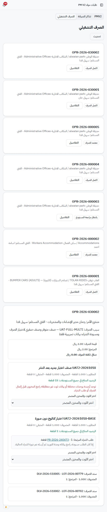
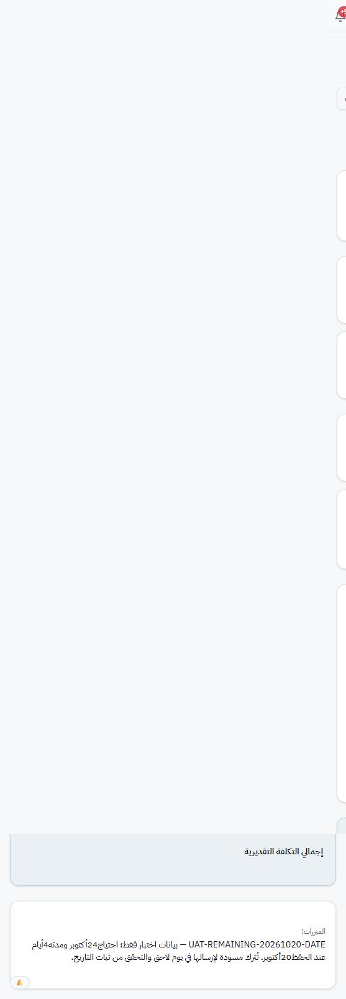

# استكمال الاختبارات الجزئية — 20 أكتوبر 2026

العمل عبر واجهة خدمة Railway التي أكد المستخدم اتصالها بـcopycmms. لم يُنفذ اتصال مباشر بالقاعدة أو SQL أو تعديل كود. المشاريع والصيانة الدورية خارج الاختبار.

## الاستبعادات المؤكدة

طلب المستخدم تجاوز التدقيق الشامل لكل API ولكل دور، والتوقيعات، ومعاينة الوثائق وزر إغلاقها. اختبار تعطيل الجلسات والأجهزة الفعلية ما زال مؤجلًا/متجاوزًا. لا تُسجل هذه الحالات ناجحة.

## 1. نقص الصرف التشغيلي — اكتمل

- المسودة 3840001 مرتبطة بـOPR-2026-030002، بند30003، صنف731026 وكمية1. حُفظ تاريخ الاحتياج24أكتوبر.
- أُرسلت وأصبحت PR-2026-240473. راجعها RED9 وأسندها إلى RED3.
- دخل RED3، وحفظ تسعيرًا تجريبيًا1ريال، وأضاف الصنف إلى DPB-2026-060002. نجح إرسال الحزمة وأُرشفت تلقائيًا، وظهر تنزيلPDF.
- نفذ المستخدم اعتمادي الحسابات والإدارة، وتأكدت حالة الطلب «معتمد» من الواجهة.
- سجّل RED9 الشراء بصور اختبار، ثم أكد التوريد عبر دورة الشراء بفاتورة UAT-OPR-SHORTAGE-20261020-01 وصورة اختبار.
- أُدخلت الفاتورة يدويًا: قطعة1، وحدة الصرف قطعة، معامل1، سعر قبل الضريبة1، ضريبة0.15 وإجمالي1.15. المورد الاختباري الجديد معلّم للمراجعة.
- صدر RCV-2026-600002 وLOT-2026-00782 بكمية1قطعة.
- ظهر اللوت مباشرة ضمن خيارات البند الأصلي في الصرف التشغيلي. نجح الصرف بسند DLV-2026-510002؛ صار المصروف1 والمتبقي0، وحالة الأمر «اكتمل الصرف»، وصافي تكلفة الأمر1ريال.
- أُعيدت القطعة كاملة بسبب اختبار موثق. عاد رصيد الصنف إلى1؛ صار مجموع صرف الأمر2 والمرتجع2 وصافي التكلفة0.

هذه تجربة ربط ناجحة من المسودة إلى الشراء والاستلام والصرف والمرتجع. لا شراء أو تسليم ميداني حقيقي. عمليات ما بعد اعتماد الحسابات بهذه الجولة نُفذت من RED9، فلا تُحسب إعادة اختبار مستقلة لصلاحيات المستودع أو المندوب.

## 2. تاريخ الاحتياج واختلاف عرض مسودة المندوب

أُنشئت المسودة3840003، بعنوان UAT-REMAINING-20261020-DATE، لتبقى مسودة حتى يوم تالٍ. صنف731025، كمية1، تاريخ24أكتوبر، ومدته4أيام عند إعدادها20أكتوبر. الأصل AST-00047 ضمن الألعاب الرئيسية.

ملاحظة جديدة: RED3 منشئ المسودة عرضت له التفاصيل0أصناف، وفتح التعديل بصف فارغ. أُعيد اختيار الصنف وحفظ التعديل ضمن المسودة التجريبية، واستمر عرض0. بالمقارنة، رأى RED9 بند3810004 محفوظًا بكمية1 وتاريخ24أكتوبر. لذلك لا نجزم بفقدان البيانات؛ العطل المثبت اختلاف عرض بنود مسودة المندوب عن عرض الإدارة. خطر أثر إعادة حفظ مسودة محجوبة البنود يحتاج فحص الكود لاحقًا؛ لم تُجر تجربة على بيانات حقيقية.

اختبار الإرسال في يوم تقويمي تالٍ لم يكتمل. لم تُغير ساعة الجهاز أو بيانات القاعدة لمحاكاة الزمن.

## 3. التحسين المرتبط بشراء وأصل — جزئي

- أنشأ RED3 فكرة IMP-2026-00017 بعنوان UAT-REMAINING-20261020-PURCHASE، بموقع حديقة الوطن، قسم الألعاب الرئيسية وأصله.
- فرز RED9 الفكرة ضمن الصيانة والتشغيل، وسجل دراسة مواد1ريال وعمالة وخدمات0 مع مبرر واضح أنها بيانات اختبار.
- رفضت الموافقة الآلية حفظ قرار اعتماد الفكرة لغياب تصريح محدد. طُلب من المستخدم التصريح لهذه الفكرة بعينها وتقدير1ريال، وأجاب «موافق». بعدها حُفظ القرار.
- حُفظت خطة تنفيذ بمسؤول اختبار وموعد25أكتوبر. تحويل «طلب شراء» نقل الموقع والقسم والأصل والمبررات ومرجع الفكرة إلى النموذج.
- صدر PR-2026-240474 برقم3840004 وبند3810005. ظهر رابط العودة إلى IMP00017 وأصل AST00047. أُسند RED3 وحُفظ التسعير التجريبي1ريال من RED9.
- لم تُختبر بعد موافقات شراء هذه الفكرة أو استلامها أو أثر تكلفتها الفعلية وتقدمها النهائي؛ توقفت الخدمة أثناء المتابعة.

## 4. حزمة شراء تقليدية متعددة الطلبات — جزئي

- محاولة تجميع PR240474 بعد انتقاله إلى التسعير رُفضت من الخادم: ليس بحالة بانتظار المراجعة. القائمة القديمة كانت لا تزال تعرضه قابلًا للتحديد. لم تُنشأ حزمة بتلك المحاولة.
- أُنشئ PR-2026-240475 برقم3840005 وبند3810006 بعنوان UAT-REMAINING-20261020-PACKAGE، كمية1 واحتياج24أكتوبر.
- جُمع مع PR240471، وهو طلب اختبار التاريخ السابق، وهما بانتظار المراجعة؛ صدرت PB-2026-150001 وتأكد وجود طلبين وصنفين.
- روجع كل طلب من تفاصيله وأُسند إلى RED3. ظهرا في الحزمة بانتظار التسعير مع تاريخيهما24و26أكتوبر.
- محاولة حفظ سعر1للعضو الثاني انتهت بأخطاء استجابة الخادم. حالة حفظ هذا السعر النهائية غير محسومة حتى تعود القراءة؛ لا تُكرر الكتابة قبل التحقق.
- لم يكتمل إرسال الحزمة للحسابات أو اعتمادها أو شروط ملفها المجمع بهذه الجولة.

## 5. تكلفة PMV2 — جزئي

فُتح طلب90001 للمهمة القائمة PMV2-20261011-P1-T1: Duracell74-061، احتياج1، الرئيسي2 والفريق0. زر التحويل نقل إلى شاشة تحويل مرتبطة بالمهمة، مع مخزنين وكمية محددين. لم تُنشأ خطة جديدة ولم تُفتح الصيانة الدورية.

لتجنب الاعتماد على تكلفة لوت قديم، حُفظ استلام مستقل تجريبي UAT-PMV2-LOT-20261020-01. رُبط بصنف المخزون INV-2026-270096، قطعة1، معامل1 وسعر1 قبل الضريبة. صدر RCV-2026-600003 وLOT-2026-00783 بكمية1قطعة.

محاولة بحث هذا اللوت في التحويل تزامنت مع فشل استجابة الخدمة. لم يُنفذ تحويله أو صرفه، ولا يُدّعى نجاح تكلفة PMV2 أو تجميع الأصل عمليًا بعد.

## عائق أوقف المتابعة

نحو17:23 بتوقيت الرياض ظهرت Unable to transform response from server في قراءة وحفظ الحزمة وصفحات PMV2. بعد إعادة القراءة ظهرت «تعذر التحقق من الجلسة مؤقتًا — لم يتم تسجيل خروجك. حاول إعادة الاتصال بالخادم» في صفحتين مستقلتين. أعيدت محاولة الاتصال من الواجهة واستمر العائق. أكد المستخدم عدم وجود نشر أو إعادة تشغيل بحسب علمه.

لم يُحدد السبب: لا تُنسب المشكلة للقاعدة أو Railway أو تعديل معين دون دليل. لا اتصال مباشر بالقاعدة ولا تغيير كلمات مرور أو صلاحيات. توقفت إعادة عمليات الحفظ التي لم تُحسم نتائجها لمنع التكرار.

## حالة الاستكمال عند العائق

| الحالة | النتيجة |
|---|---|
| شراء نقص التشغيل حتى الصرف والمرتجع | مكتمل وناجح |
| فكرة ذات تكلفة غير صفرية وربط شراء وأصل | وصل إلى طلب شراء مسعّر؛ بقية الدورة غير مكتملة |
| حزمة تقليدية جديدة بطلبين | أُنشئت ورُوجع أعضاؤها؛ التسعير/الإرسال/الاعتماد غير مكتمل |
| PMV2 | لوت جديد وتجهيز التحويل؛ الصرف والتكلفة غير مكتملين |
| التجميع حسب أصل فعلي | الربط محفوظ في طلب الفكرة؛ تقرير تكلفة فعلية على الأصل لم يُثبت |
| الإرسال في يوم تالٍ | مسودة جاهزة؛ يحتاج يومًا فعليًا لاحقًا |

## أدلة

